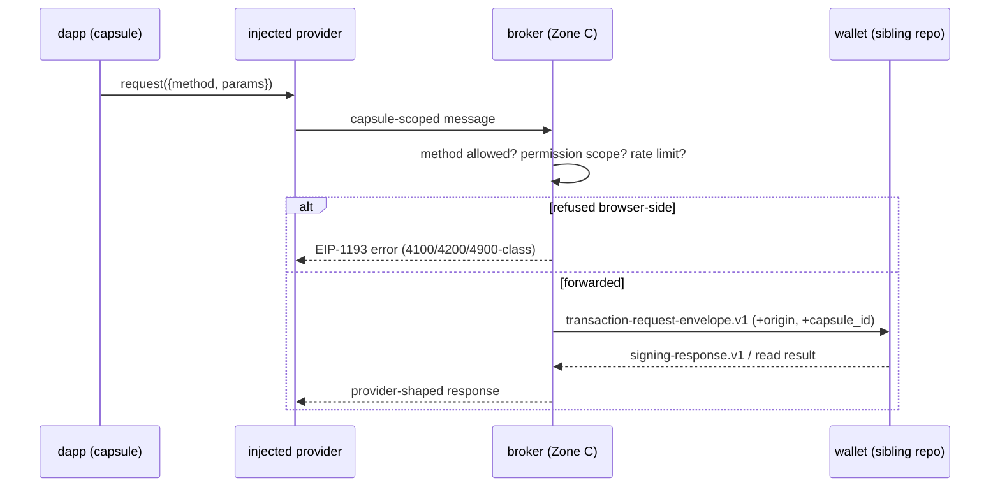

# Provider and Capability Broker (Zone C)

**Version:** 0.2 (design document; gate OPEN since ADR-B003, MVP shell landed per ADR-B004 — implementation status: broker-core partial, see docs/testing/dapp-compat-matrix.md)

The broker is the only path from dapp content to privileged services. It is browser-side plumbing with **zero authority**: it validates, scopes, attaches identity, rate-limits, forwards, and renders results. All decisions (policy, signing, confirmation) happen wallet-side.

## Responsibilities (BS §7.1 Zone C)

1. **Expose a standard provider** (EIP-1193 shape) to each capsule so existing dapps work unmodified.
2. **Validate request type** against the wallet's advertised capability (`wallet-capability.v1`): unsupported methods are rejected with a proper provider error, never silently dropped or guessed.
3. **Attach identity**: dapp origin + `capsule_id` on every message (`transaction-request-envelope.v1` `caller`). The wallet rejects identity-less envelopes; the broker must never fabricate or generalize identity.
4. **Enforce per-site permissions** before forwarding (see `per-site-permissions.md`): account tier filters, network allowlists, read-only mode, expiry.
5. **Route by consequence**: read-only requests (chain id, block number, balances for disclosed accounts) may be served from the wallet's read path; signing-class requests always traverse the full wallet pipeline.
6. **Rate-limit and size-cap** per capsule (DoS posture, wallet T-22).
7. **Log**: every forwarded/refused request produces an auditable record (wallet audit log carries the events; the broker adds capsule context).
8. **Timeouts and denial semantics**: a request the user ignores expires to a clean provider error (code + message); denial reasons surface to the dapp only in coarse form (no policy internals leak to hostile pages).

## Request lifecycle

## Non-negotiables

- The broker never sees key material, never composes signatures, never overrides a wallet refusal, and never retries a denied request without a fresh user action.
- Method allowlist is deny-by-default: unknown methods → rejected (wallet invariant mirrored browser-side).
- Broker code is Zone C, not Zone A: it must not depend on themes, extensions, or anything a page can influence.

## Open design items (pre-gate work allowed)

Transport + peer authentication to the wallet (protocol v0.2) · capsule identity attestation · provider-compat quirks table (see compatibility test plan) · error-code mapping table EIP-1193 ↔ wallet refusal reasons.
