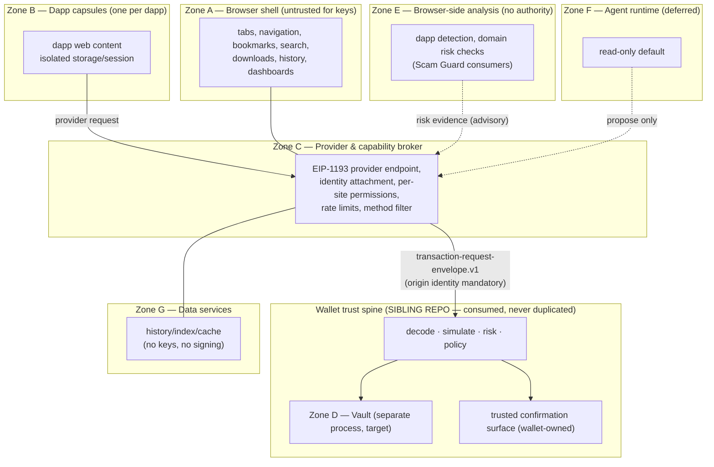

# Browser Trust-Zone Architecture

**Version:** 0.1 (design document; no implementation exists — gate closed) · Zones follow BS §7.1 and align with the wallet repo's `trust-boundaries.md`.

## Zone rules

| Zone | May | Must never |
|---|---|---|
| A — shell | render chrome, manage tabs/profiles, display evidence | hold keys; render or imitate confirmation surfaces; make security decisions |
| B — capsules | run dapp content in isolation | reach other capsules' storage/permissions; talk to the wallet except through C |
| C — broker | validate, attach origin identity + capsule ID, enforce per-site permissions, rate-limit, forward | sign, decide policy, strip identity, widen scope |
| D — Vault | (wallet repo) | exist in this codebase at all |
| E — analysis | produce risk evidence with provenance | acquire signing authority; suppress evidence |
| F — agents | (deferred) read-only, propose | sign; bypass USER_REVIEW |
| G — data | index, cache, alert | hold key material; be trusted for chain truth without provenance |

## Boundary properties required before implementation

1. Zone B → C is the only path out of a capsule for Web3 traffic (no direct sockets to the wallet transport).
2. Zone C → wallet transport authenticates the browser process to the wallet (protocol v0.2 open item) and is unreachable from arbitrary web content.
3. The confirmation surface belongs to the wallet process; the browser can occlude but never draw it. Anti-spoofing requirements: `trusted-confirmation-surface.md`.
4. Renderer compromise (any capsule, or the shell) must yield **zero** key material and no signing authority — it can at most propose requests that still traverse decode → simulate → risk → policy → USER_REVIEW.
5. Every crossing is auditable via the wallet's audit log (the browser adds capsule/origin context, never removes it).
